<!-- Gerado por scripts/build_profile.py. Para mudar textos, links, relatórios
e projetos, edite config/perfil.json: o GitHub Action refaz tudo sozinho. -->

<picture><source media="(prefers-color-scheme: dark)" srcset="./cards/escuro/hero.svg" /></picture>
<picture><source media="(prefers-color-scheme: dark)" srcset="./cards/escuro/numeros.svg" /></picture>
  

<picture><source media="(prefers-color-scheme: dark)" srcset="./cards/escuro/titulo-relatorios.svg" /></picture> 
<a href="https://app.powerbi.com/view?r=eyJrIjoiZjU1YjMxODQtNjg0Mi00ZTU0LThmNTEtODllZjI5YjQ5MDE4IiwidCI6ImI5NGI1ZDk3LTQzNDgtNGE5MS05NmU0LThkMzc4NTMwYjYxOCJ9"><picture><source media="(prefers-color-scheme: dark)" srcset="./cards/escuro/relatorio-1.svg" /></picture></a> <a href="https://visuals-powerbi.vercel.app/"><picture><source media="(prefers-color-scheme: dark)" srcset="./cards/escuro/relatorio-2.svg" /></picture></a> <a href="https://nbviewer.org/github/DaviMark/santander-satisfaction/blob/main/SantanderCustomerSatisfaction.ipynb"><picture><source media="(prefers-color-scheme: dark)" srcset="./cards/escuro/relatorio-3.svg" /></picture></a>
  

<a href="https://github.com/DaviMark?tab=repositories"><picture><source media="(prefers-color-scheme: dark)" srcset="./cards/escuro/titulo-projetos.svg" /></picture></a> 
<picture><source media="(prefers-color-scheme: dark)" srcset="./cards/escuro/pipeline.svg" /></picture> 
<a href="https://github.com/DaviMark/projeto_jira_databricks"><picture><source media="(prefers-color-scheme: dark)" srcset="./cards/escuro/projeto-1.svg" /></picture></a><a href="https://github.com/DaviMark/projeto_github_lakehouse"><picture><source media="(prefers-color-scheme: dark)" srcset="./cards/escuro/projeto-2.svg" /></picture></a><a href="https://github.com/DaviMark/Consultas_SQL"><picture><source media="(prefers-color-scheme: dark)" srcset="./cards/escuro/projeto-3.svg" /></picture></a>
  

<picture><source media="(prefers-color-scheme: dark)" srcset="./cards/escuro/atividade.svg" /></picture>
  

<picture><source media="(prefers-color-scheme: dark)" srcset="./cards/escuro/ferramentas.svg" /></picture>
  

<picture><source media="(prefers-color-scheme: dark)" srcset="./cards/escuro/contato.svg" /></picture>

<a href="https://www.linkedin.com/in/david-deliberto-marques/"><picture><source media="(prefers-color-scheme: dark)" srcset="./cards/escuro/botao-linkedin.svg" /></picture></a><a href="mailto:davideliberto2001@gmail.com"><picture><source media="(prefers-color-scheme: dark)" srcset="./cards/escuro/botao-email.svg" /></picture></a><a href="https://github.com/DaviMark/Formacao-Certificados"><picture><source media="(prefers-color-scheme: dark)" srcset="./cards/escuro/botao-certificados.svg" /></picture></a>

