<!-- Gerado por scripts/build_profile.py. Para mudar textos, links e projetos,
edite config/perfil.json: o GitHub Action refaz tudo sozinho. Mantenha as imagens de cada linha coladas. -->

 
   

