<!-- Este README é gerado por scripts/build_profile.py.
Para mudar textos, links, relatórios e projetos, edite config/perfil.json:
o GitHub Action refaz tudo sozinho. Mantenha as imagens de cada linha coladas, sem espaços. -->

 
 
 
 
 
 
 
 
 

