<!-- gráfico de contribuições animado: dados reais, células aparecem uma a uma
(atualizado todo dia por .github/workflows/update-profile-art.yml) -->

<h3><code>davi@github ~ $ ./contributions.sh</code></h3>

 
 

<!-- retrato ASCII (esquerda) + painel de sequência/números (direita).
os dois SVGs têm 840x880, então larguras iguais dão alturas iguais.
retrato: coloque sua foto em assets/foto.png e rode o workflow manualmente
números: scripts/render_stats_svg.py (mesmo workflow diário) -->

<h3><code>davi@github ~ $ whoami</code></h3>

<table>
<tr>
<td valign="top"></td>
<td valign="top"></td>
</tr>
</table>

 
 

<h3><code>davi@github ~ $ ./links.sh</code></h3>

<b>Analytics Engineer · Engenheiro de Dados · Power BI Developer</b>

 

